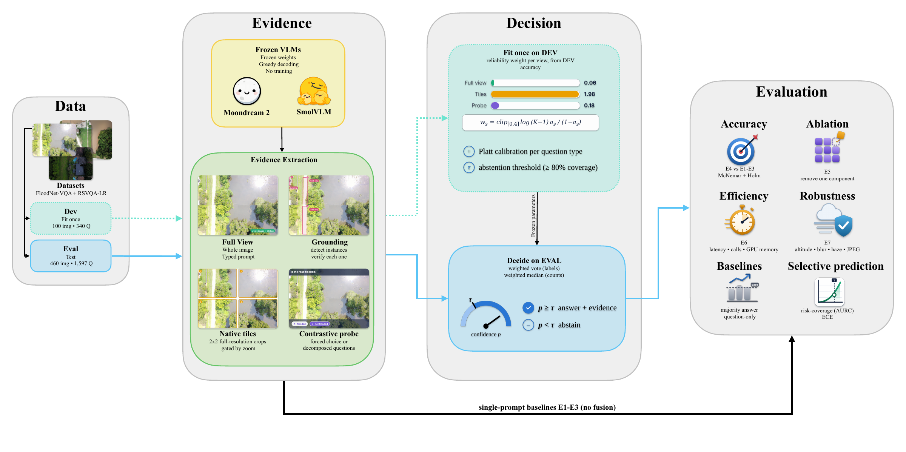

# AeroVerify-VLM

**A training-free, evidence-grounded framework for reliable visual question answering on UAV imagery with small vision–language models.**

AeroVerify-VLM asks a small VLM the same question through several independent *evidence sources*. It fuses their answers with *reliability weights* estimated on a small development split, and it abstains when the calibrated confidence is low. The model is never fine-tuned.



| Evidence source | What it does |
|---|---|
| Full view (E2) | Whole image with a type-specific prompt |
| Native tiles (E3) | 2×2 full-resolution tiles. A *resolution gate* uses them only when tiles carry more pixels than the model's input |
| Contrastive probe | Forced-choice or decomposed questions that avoid yes/no tokens |
| Grounding | Instance detection and per-instance verification (e.g. *flooded or dry?*) |

The answers are combined by **reliability-weighted fusion**: the weight of source *s* is clip(log((K−1)·a<sub>s</sub>/(1−a<sub>s</sub>)), 0, 4), where a<sub>s</sub> is its DEV accuracy. The fused confidence is then calibrated per question type with Platt scaling on DEV, and **abstention** applies a threshold τ that is also chosen on DEV.

Models: [Moondream2](https://huggingface.co/vikhyatk/moondream2) (revision `2025-06-21`) and [SmolVLM-Instruct](https://huggingface.co/HuggingFaceTB/SmolVLM-Instruct).
Datasets: [FloodNet-VQA](https://github.com/BinaLab/FloodNet-Challenge-EARTHVISION2021) (UAV, 4000×3000 px) and [RSVQA-LR](https://zenodo.org/records/6344334) (Sentinel-2, 10 m).

## Main results (EVAL split)

| | FloodNet · Moondream2 | FloodNet · SmolVLM | RSVQA-LR · Moondream2 | RSVQA-LR · SmolVLM |
|---|---|---|---|---|
| E2 structured prompt (OA %) | 73.1 | 68.1 | 56.1 | 53.0 |
| **AeroVerify, full coverage (OA %)** | 71.9 | **75.1** | **58.6** | **58.1** |
| Δ vs E2 (Holm-corrected McNemar *p*) | −1.2 (0.25) | **+7.0** (4.8e-10) | **+2.5** (0.012) | **+5.2** (0.036) |
| AeroVerify, selective: accuracy @ coverage | 82.1 % @ 84 % | 84.0 % @ 83 % | 62.9 % @ 86 % | 58.1 % @ 100 % |

**Highlights**

- **The weights find the unreliable source on their own.** SmolVLM's full-view answers to FloodNet yes/no questions are near chance (49.4%, weight 0.06), while its native-resolution tiles are reliable (85.8%, weight 1.98). Fusion lifts yes/no accuracy from 49.4% to 85.8%, which accounts for most of the +7.0 point gain.
- **Hallucinated "yes" answers disappear.** On FloodNet "no" questions, SmolVLM's structured prompt says "yes" 21.8% of the time; AeroVerify brings that to 0.0%.
- **Confidence becomes trustworthy.** Type-conditional calibration fit on DEV cuts expected calibration error on EVAL from 16.4 → 6.3 and 11.6 → 3.6 (FloodNet), and 13.6 → 3.1 and 6.4 → 3.3 (RSVQA-LR).
- **Better risk–coverage than calibrated alternatives for SmolVLM:** AURC 8.1 vs 10.9 for self-consistency on FloodNet, and 24.4 vs 31.1 for the best alternative on RSVQA-LR.
- **Honest limits.** For Moondream2 on FloodNet, AeroVerify is statistically tied with its strong single prompt, and RSVQA-LR sits near a resolution ceiling where no method beats the most-common-answer baseline significantly.

All intervals are 95% image-level cluster bootstrap; paired tests use exact McNemar with Holm correction. See the paper for per-type results, ablations, robustness and cost.

## Repository layout

```
code/
  setup.sh               one-time setup: .venv, caches, Jupyter kernel
  run_experiments.sh     runs the notebook headless (smoke | pilot | data | moondream2 | smolvlm | analyze)
  requirements.txt
notebooks/
  aeroverify_vlm_v2.ipynb   the full pipeline: data → inference → analysis → figures and tables
notebook_src/
  cells/                 source of every notebook cell
  build_nb.py            rebuilds notebooks/aeroverify_vlm_v2.ipynb from cells/
  dry_run.py             executes the notebook in-process (used for CPU smoke tests)
splits/
  sample_questions.csv   the exact DEV/EVAL questions used in the paper (both datasets)
outputs/
  sample_questions.csv   RSVQA-LR split in the format the notebook reuses
```

## Requirements

- Linux with an NVIDIA GPU. The paper's runs used 2× RTX 4090 (24 GB), Ubuntu 22.04, Python 3.10, PyTorch 2.7.0 + CUDA 12.8 and transformers 4.51.3.
- Roughly 20 GB of disk for the Python environment, model weights, the sampled FloodNet images and RSVQA-LR.
- The smoke test runs on CPU only.

## Quick start

```bash
git clone https://github.com/mustafanfj/AeroVerify-VLM.git
cd AeroVerify-VLM
bash code/setup.sh                          # once
bash code/run_experiments.sh smoke          # 1–2 min: synthetic data + mock models, checks the whole pipeline
bash code/run_experiments.sh data           # downloads FloodNet-VQA annotations + sampled images, and RSVQA-LR
bash code/run_experiments.sh moondream2 0   # inference on GPU 0  (~3 h)
bash code/run_experiments.sh smolvlm 1      # inference on GPU 1  (~4 h, can run in parallel)
bash code/run_experiments.sh analyze        # tables + figures (CPU, ~2 min)
```

Run the two inference commands inside `tmux` or `screen`. Every model call is cached in `outputs_v2/cache/`, so an interrupted run resumes where it stopped, and `analyze` never calls a model.

Any setting can be overridden with an environment variable. Examples:
- `AV_ROBUSTNESS=0`: skip the degradation study.
- `AV_DATASETS=floodnet`: run one dataset only.
- `AV_FN_EVAL=100`: use a smaller FloodNet EVAL sample.

The full list is in the first notebook cell.

## Outputs

`analyze` writes:
- `outputs_v2/figures/*.pdf`: IEEE double-column width, embedded fonts.
- `outputs_v2/tables/*.csv` and `*.tex`: every reported number. This includes `table_selective.csv` (AURC with paired bootstrap CIs) and `all_predictions_long.csv` (one row per question × method).
- `outputs_v2/summary.txt`: the headline numbers.

## Reproducibility

- **Data splits.** DEV is used only for the reliability weights, calibration and τ. Every reported number comes from EVAL. FloodNet images are drawn with a fixed seed (2026). The RSVQA-LR sample is read from `outputs/sample_questions.csv`. `splits/sample_questions.csv` lists every question ID used.
- **Inference.** Decoding is greedy, and model revisions are pinned.
- **Statistics.** Confidence intervals come from a cluster bootstrap over images. Accuracy differences use exact McNemar tests with Holm correction. AURC differences use a paired image-level bootstrap.

## Datasets and licences

The datasets are not redistributed here; the notebook downloads them from their original sources. FloodNet-VQA is fetched from its Hugging Face mirror and RSVQA-LR from Zenodo. Please follow the licence and citation requirements of [FloodNet](https://github.com/BinaLab/FloodNet-Challenge-EARTHVISION2021) and [RSVQA](https://rsvqa.sylvainlobry.com/).

## Citation

Under review at the *IEEE Open Journal of Vehicular Technology*. A BibTeX entry will be added here on publication.

## Licence

Code released under the [MIT Licence](LICENSE). © 2026 Mustafa Al Juboori, Autonomous Systems Lab, College of Computing and AI, UAE University.
